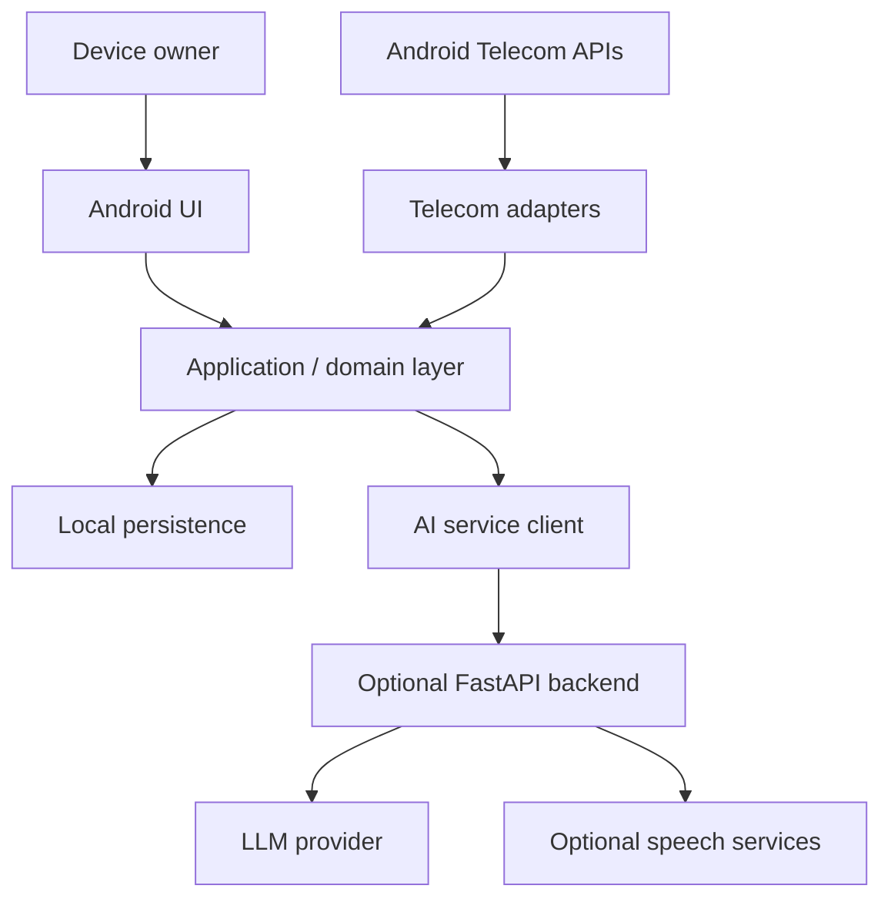
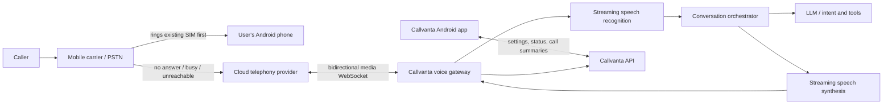

# Callvanta — Architecture

## 1. Architectural principles

- Android platform APIs are the authority for call state and supported telecom operations.
- Keep call-screening decisions independent of remote AI services.
- Separate presentation, telecom adapters, domain logic, persistence, and network clients.
- Treat AI-generated content as derived data and label it accordingly.
- Make privacy and consent requirements part of feature design.
- Use a provider-neutral AI boundary so the model provider can change without redesigning the Android app.

## 2. High-level component view

The diagram is conceptual. It does not imply that Android exposes unrestricted cellular-call audio to the app.

## 3. Android client layers

### Presentation layer — `app/.../ui/`

Responsibilities:
- Dashboard and setup flow.
- Call history and call detail screens.
- Screening preferences and privacy settings.
- Permission and default-dialer role explanations.
- Loading, unavailable, and error states.

Suggested feature areas:
- `dashboard/`
- `calls/`
- `settings/`
- `onboarding/`

### Telecom integration — `app/.../telecom/`

Responsibilities:
- Adapt supported Android Telecom callbacks into app-level events.
- Implement call screening as a bounded, deterministic operation.
- Later evaluate default-dialer integration through `InCallService`.
- Report capability availability and failures to the domain layer.

Key platform boundaries:
- `CallScreeningService`: screening decisions, not an AI call conversation.
- `InCallService`: default-dialer in-call UI/control integration, subject to role and API contracts.
- Cellular call audio: restricted; do not assume direct access to uplink/downlink streams.

### Domain layer — `app/.../domain/`

Responsibilities:
- Call and caller models.
- Screening policy and decision rules.
- Use cases for call history and settings.
- Interfaces for repositories and optional AI operations.
- Capability checks and feature gating.

### Data layer — `app/.../data/`

Responsibilities:
- Local persistence using Room when implementation begins.
- Repository implementations.
- Data mapping and retention/deletion behavior.
- Secure handling of user-controlled configuration.

### AI and speech boundary — `app/.../ai/`

Responsibilities:
- Define provider-independent request/response contracts.
- Coordinate permitted speech recognition and speech synthesis.
- Request caller-purpose extraction or summarization only from data the app is allowed to process.
- Handle timeouts, offline state, and service failures.

Do not put provider secrets in this package or in the APK.

## 4. Optional backend

Proposed backend: Python + FastAPI.

Responsibilities:
- Authenticate app requests.
- Validate and minimize submitted data.
- Call the configured LLM provider using server-side secrets.
- Return structured, bounded outputs such as summaries or caller-purpose labels.
- Apply rate limits, request limits, and privacy-aware logging.

The backend is optional for core app operation. A backend outage must not prevent basic call UI, local settings, or local call records from functioning.

## 5. Data flow

### Screening flow

1. Android invokes the screening service for an incoming call.
2. The service reads only available call metadata.
3. A local policy evaluates the configured rule.
4. The service returns a supported screening response within the platform deadline.
5. The app stores the result and updates the UI when permitted.

No remote LLM call should be required to meet the screening deadline.

### Post-call summary flow (future, conditional)

1. Obtain permitted text or other supported input.
2. Clearly disclose any remote processing.
3. Send the minimum necessary data to the backend.
4. Backend validates and requests a structured summary from the model provider.
5. App labels the result as AI-generated and stores it only according to user settings.

This flow does not presume that cellular call audio can be captured.

## 6. Proposed data entities

- `CallRecord`: call identifier, number/contact reference when available, timestamps, direction, duration when available, screening outcome.
- `CallerProfile`: user-managed caller label and notes.
- `ScreeningRule`: enabled state, matching criteria, selected action.
- `CallInsight`: AI-generated purpose or summary, source type, created timestamp.
- `AppPreferences`: privacy, retention, and feature settings.

Store only necessary fields. Avoid retaining raw audio by default.

## 7. Security boundaries

- Android permissions and role grants are user-controlled.
- Backend credentials are held in deployment secrets/environment variables.
- App-to-backend requests use authenticated transport.
- Do not commit API keys, tokens, personal call data, or real transcripts.
- Logs must avoid sensitive caller content.
- Provide deletion and retention controls.

## 8. Quality attributes

- Modular boundaries allow telecom implementation to be tested separately from UI.
- Screening path is local and predictable.
- AI calls are asynchronous and never block telecom callbacks.
- Capability detection gates unsupported features.
- Interfaces permit mock implementations for tests when implementation begins.

## 9. AI receptionist architecture — conditional forwarding

The selected product direction is to preserve the user's existing SIM number and use carrier conditional call forwarding to reach a cloud AI receptionist. This is a separate telephony path from Android's `CallScreeningService`.

### Responsibilities

- **Carrier/PSTN:** performs conditional forwarding from the existing mobile number to a telephony-provider destination. The carrier controls forwarding conditions and caller-ID behavior.
- **Telephony provider:** answers the forwarded leg and exposes caller audio plus a supported return-audio channel. Provider account approval and feature availability are prerequisites.
- **Voice gateway:** Python/FastAPI service with a WebSocket media endpoint; validates provider events, manages per-call sessions, streams audio, enforces timeouts, and closes sessions safely.
- **Speech/LLM pipeline:** streaming STT → conversation orchestrator → LLM/tool execution → streaming TTS. Keep provider interfaces replaceable.
- **Android app/API:** configures user preferences, shows service readiness and call history, and displays summaries/collected details. It does not capture SIM call audio.

### Provider integration boundary

Exotel is the initial candidate, not a hard dependency. Its documented Voicebot Applet supports bidirectional WebSocket media. Implement a provider adapter boundary (for example, TelephonyProviderAdapter) so another compliant provider can be substituted without changing conversation logic. Verify Exotel feature enablement, India number/account eligibility, forwarding compatibility, media format, webhook authentication, pricing, and legal requirements before production use.

### Call lifecycle and privacy

1. Receive provider call-start event and create an ephemeral call session.
2. Play an AI identity and privacy disclosure before collecting caller information.
3. Stream audio to speech recognition and return generated speech through the provider's bidirectional channel.
4. Collect only user-configured fields; label uncertain AI interpretations.
5. End the call on caller request, configured timeout, provider disconnect, or safety escalation.
6. Persist minimal call metadata and user-approved outcomes. Raw audio/transcripts are off by default and require a separately approved retention/consent policy.
7. If the AI service fails, use provider-supported fallback routing (voicemail, human number, or safe hang-up message); never leave a silent connected call.

### Security requirements

- Store provider credentials, LLM keys, and speech-service keys only in backend secret storage.
- Verify provider webhook signatures/tokens and reject replayed or malformed events.
- Use WSS, per-call session isolation, bounded message sizes, rate limits, and maximum call duration.
- Never expose provider credentials or privileged media endpoints in the Android APK.
